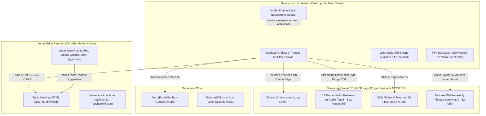

# PELIMOTION — Digital Studio, Creative Direction & Spatial Experiences
> **Repositório Mestre do Ecossistema Pelimotion & Pavilhão Tridimensional Gigantera**  
> Produção: **[pelimotion.art](https://pelimotion.art)** | Intake & Scoping Hub: **[pelimotion.art/bora](https://pelimotion.art/bora)** | Pavilhão 3D: **[pelimotion.art/gigantera](https://pelimotion.art/gigantera)**

---

## 🧭 Sumário Executivo para Líderes Técnicos & Diretores Criativos

Bem-vindo ao repositório oficial da **Pelimotion**. Este ecossistema reúne portfólio comercial de alto impacto, central de orçamentação e intake de briefing em Black Neumorphism (`/bora`), painel administrativo de gestão de mídia (`/admin`), motor de automação de campanhas (`/ads`), hub editorial (`/blog`) e uma das mais avançadas galerias tridimensionais brutalistas da web contemporânea (**Gigantera**).

Este documento é o guia definitivo para **Engenheiros de Software Sênior**, **Programadores de WebGL/Frontend** e **Diretores de Criação/Design** assumirem, desenvolverem e operarem o projeto com excelência e autonomia total.

---

## 🏛️ Topologia Arquitetural do Ecossistema

O projeto adota uma arquitetura híbrida de **Zero-Bandwidth Origin + Global Media Edge**, garantindo custo mínimo de infraestrutura, velocidade sub-segundo em escala global e conformidade estrita com as cotas da Vercel.



---

## 🗺️ Matriz de Subprojetos e Módulos

| Rota / Módulo | Stack Tecnológica | Responsabilidade / Funcionalidade | Documentação |
| :--- | :--- | :--- | :--- |
| **`/` (Raiz)** | HTML5, CSS3 Vanilla, JavaScript Moderno | Landing page principal, portfólio comercial e reel cinético | [`index.html`](./index.html) & [`README.md`](./README.md) |
| **`/bora`** | HTML5, CSS Neumorphic, Web Audio API | Mote *"Bora crescer juntos. Movimente-se com a gente."*, Questionário de escopo técnico, gerador de protocolo (`BORA-26-XXXX`) e saída dupla WhatsApp / E-mail | [`bora/index.html`](./bora/index.html) |
| **`/gigantera`** | React 19, TypeScript, Vite, Three.js, Web Audio API, GSAP | Pavilhão brutalista 3D, CD Jewel Case em POV, Modo Loupe e Mobile | [`gigantera/README.md`](./gigantera/README.md) |
| **`/admin`** | HTML5, CSS3, JavaScript Vanilla, Bunny API | Painel de controle de mídia, Deploy Hub, gerador de GIFs via WASM | [`admin/index.html`](./admin/index.html) |
| **`/ads`** | HTML5, Space Grotesk, Autopilot Engine | Painel de controle de campanhas e inteligência de tráfego | [`ads/index.html`](./ads/index.html) |
| **`/briefing`** | HTML5, Supabase Client, Canvas Sequence | Formulário de briefing imersivo com canvas animado de fundo | [`briefing/index.html`](./briefing/index.html) |
| **`/blog`** | HTML5 procedural, RSS XML | Hub editorial e artigos de motion/design com SEO e RSS | [`blog/`](./blog/) |
| **`/curriculum`** | HTML5 semântico, CSS print-ready | Currículo interativo e exportação de PDF de alta fidelidade | [`Curriculum/`](./Curriculum/) |
| **`/login`** | HTML5, DM Mono, Supabase Auth | Portal de acesso ao studio com autenticação Google / Email | [`login/index.html`](./login/index.html) |
| **`/penumbra`** | TouchDesigner Web Bridge, NDI Telemetry | Cockpit do sistema de engine áudio-reativa VJ | [`penumbra/index.html`](./penumbra/index.html) |
| **`/legacy` (`/v1`)** | HTML5, Canvas Espectrais | Versão original do portfólio com navegação clássica | [`legacy/V1/portfolio/`](./legacy/V1/portfolio/) |

---

## 🖤 Identidade Visual & Design System Oficial

### 1. Família Oficial de Símbolos (`PLM_SIMBOLO`)
O branding da Pelimotion é padronizado estritamente nos seguintes arquivos na raiz do repositório:
- **`PLM_SIMBOLO_BRANCO.png`**: Símbolo oficial horizontal para fundo escuro (Dark Mode).
- **`PLM_SIMBOLO_PRETO.png`**: Símbolo oficial horizontal para fundo claro (Light Mode).
- **`PLM_SIMBOLO_REDUZIDO_BRANCO.png`**: Monograma compacto para avatares e badges em modo escuro.
- **`PLM_SIMBOLO_REDUZIDO_PRETO.png`**: Monograma compacto para avatares e badges em modo claro.

### 2. Favicon Oficial (`LOGO.ico`)
- **`LOGO.ico`** (e fallback `logo.ico`): Ícone multi-resolução oficial da marca.
- Substituiu em definitivo o antigo arquivo vetorial `logo.svg` em todas as páginas do site.
- Regra de rewrite mapeada no [`vercel.json`](./vercel.json) para garantir compatibilidade multiplataforma.

### 3. Padrões Visuais da Marca (`assets/patterns/`)
- **`assets/patterns/pattern01_web.jpg`**, **`pattern02_web.jpg`**, **`pattern03_web.jpg`**: Texturas de alta resolução da marca 2026, otimizadas para carregamento web rápido e aplicadas com blending sutil em marca d'água (`mix-blend-mode: screen`, opacidade 3% a 5%).

### 4. Estética Black Neumorphic Minimalist (`/bora`)
- **Zero Ruído de Cores:** Paleta monocromática estrita em obsidiana mate (`#08080a`, `#0e0e12`, `#131318`), titânio e prata lunar (`#EDEDF0`, `#9A9AA6`, `#52525E`).
- **Superfícies Táteis Esculpidas:**
  - *Extrusão suave:* `box-shadow: 8px 8px 24px rgba(0,0,0,0.75), -6px -6px 20px rgba(255,255,255,0.025)`.
  - *Cavidades Debossed:* `box-shadow: inset 4px 4px 10px rgba(0,0,0,0.85), inset -3px -3px 8px rgba(255,255,255,0.035)`.
  - *Bordas Hairline Sheen:* 1px de borda com reflexo rasante superior `rgba(255,255,255,0.12)`.
- **Audio Haptics Harmônico:** Micro-sintetizador Web Audio API embutido que dispara tons senoidais suaves em cada interação, com controle de silenciamento no topo.

---

## ⚙️ Estrutura de Diretórios Limpa & Pasta de Backup

O repositório foi higienizado e reorganizado. Todo o material bruto, pesado e histórico que **não é necessário no deploy** foi isolado na pasta:
```
/_BACKUP_PARA_REMOVER/
  ├── Medias_Portfolio/      (~14 GB de vídeos brutos já servidos pelo Bunny CDN)
  ├── Site_Antigo_2025/      (~762 MB do site antigo de 2025)
  ├── venv_cropper/          (~69 MB de virtualenv local)
  ├── technical_audit/       (Snapshots temporários de auditoria)
  ├── scratch/               (Scripts descartáveis de teste)
  ├── ai_memory/             (Memórias e logs de sessões passadas)
  ├── logos_antigas_duplicadas/ (Arquivos de logo redundantes)
  └── README_BKP.md          (Instruções completas para remoção segura)
```

> [!TIP]
> A pasta `_BACKUP_PARA_REMOVER` está listada em `.gitignore` e `.vercelignore`. Você pode arrastá-la para um HD/SSD externo ou deletá-la a qualquer momento sem afetar o funcionamento do site em produção.

---

## 🚀 Pipeline de Build & Deploy Contínuo

- **Build de Distribuição:**
  ```bash
  npm run build
  # Executa scripts/build.js, limpando e gerando a pasta /dist com todos os módulos e símbolos
  ```
- **Deploy:** Vercel via Git Push na branch `main`.
- **Roteamento SPA:** Definido centralizadamente em [`vercel.json`](./vercel.json).

---
*Pelimotion — Creative Direction, Spatial Art Direction & Motion Branding. 2026.*
