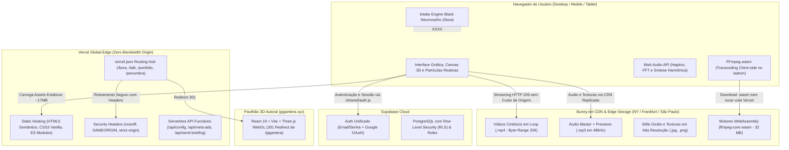

# PELIMOTION — Creative Direction & Motion Branding Atelier
> **Repositório Oficial do Ecossistema Pelimotion**  
> Produção Global: **[pelimotion.art](https://pelimotion.art)** | Intake & Scoping Hub: **[pelimotion.art/bora](https://pelimotion.art/bora)** | Pavilhão 3D: **[gigantera.xyz](https://gigantera.xyz)**

---

## 🧭 Sumário Executivo

A **Pelimotion** é um ateliê de direção criativa e motion branding sediado no Centro do Rio de Janeiro com atendimento global. Criamos sistemas visuais cinéticos, filmes CGI de alta precisão, cenografias imersivas e pipelines generativos integrados a IA para marcas que recusam o genérico e definem o ritmo do mercado.

Este repositório consolida o ecossistema digital da Pelimotion: landing page institucional, hub de intake e orçamentação técnica (`/bora`), catálogo completo de projetos (`/portfolio`), currículo executivo (`/curriculum`), cockpit de telemetria audiovisual em tempo real (`/penumbra`), motor de automação de campanhas (`/ads`), painel administrativo de mídia (`/admin`) e portal de acesso unificado (`/login`).

---

## 💎 Marcas & Clientes Atendidos

Com mais de 8 anos de prática e mais de 40 campanhas de marca veiculadas em 12 países, o estúdio desenha a linguagem cinética de grandes players nos setores automotivo, financeiro, alta moda, bioindústria e cultura:

```
BMW · Subaru · Hyundai · Shell · SPFW · Unibrasil · EQI · Motul · Suzano · O Boticário · Colcci · CAOA Tiggo · Movida · Rockset
```

---

## 🏛️ Topologia Arquitetural (Zero-Bandwidth Origin + Media Edge)

O projeto adota uma arquitetura híbrida projetada para velocidade instantânea (sub-segundo) na borda, zero custo de banda excedente na origem e streaming de alta fidelidade via CDN dedicada:



---

## 🗺️ Matriz de Subprojetos e Módulos

| Rota / Módulo | Stack Tecnológica | Responsabilidade / Funcionalidade | Arquivo de Entrada |
| :--- | :--- | :--- | :--- |
| **`/` (Home)** | HTML5, CSS Vanilla, JavaScript Nativo | Hero reel cinético, manifesto NÓS, marcas atendidas e portfólio | [`index.html`](./index.html) |
| **`/bora`** | HTML5, CSS Neumorphic, Web Audio API | Intake de escopo técnico, gerador de protocolo `BORA-26-XXXX`, saída dupla WhatsApp/E-mail | [`bora/index.html`](./bora/index.html) |
| **`/portfolio` (`/v1`)** | HTML5, Canvas Espectrais, Grid Dinâmica | Catálogo completo de trabalhos e filmes com modal de alta resolução | [`legacy/V1/portfolio/index.html`](./legacy/V1/portfolio/index.html) |
| **`/curriculum`** | HTML5 semântico, CSS Print-ready | Dossiê de carreira, histórico e capabilities de Felipe Conceição | [`Curriculum/index.html`](./Curriculum/index.html) |
| **`/penumbra`** | Web Bridge TouchDesigner, Telemetria NDI | Cockpit de controle e monitoramento de engine áudio-reativa VJ | [`penumbra/index.html`](./penumbra/index.html) |
| **`/briefing`** | HTML5, Supabase Client, Canvas Sequence | Formulário de briefing imersivo com sequence visual em background | [`briefing/index.html`](./briefing/index.html) |
| **`/ads`** | HTML5, Space Grotesk, Autopilot Engine | Painel de inteligência de tráfego e campanhas de distribuição | [`ads/index.html`](./ads/index.html) |
| **`/admin`** | HTML5, CSS3, JS Vanilla, Bunny API | Painel de controle de mídia, deploy hub e conversor de GIFs | [`admin/index.html`](./admin/index.html) |
| **`/login`** | HTML5, DM Mono, Supabase Auth | Portal seguro com autenticação unificada Google / Email | [`login/index.html`](./login/index.html) |
| **`/blog`** | HTML5 procedural, RSS XML | Hub de artigos técnicos, ensaios e reflexões sobre motion branding | [`blog/index.html`](./blog/index.html) |
| **`/gigantera`** | 301 Redirect para `gigantera.xyz` | Redirecionamento permanente para o pavilhão 3D independente | [`vercel.json`](./vercel.json) |

---

## 🖤 Identidade Visual & Design System Oficial

### 1. Família Oficial de Símbolos (`PLM_SIMBOLO`)
O branding oficial é estritamente padronizado nos seguintes ativos vetoriais e rasterizados:
- **`PLM_SIMBOLO_BRANCO.png`**: Símbolo horizontal oficial para fundo escuro (Dark Mode).
- **`PLM_SIMBOLO_PRETO.png`**: Símbolo horizontal oficial para fundo claro (Light Mode).
- **`PLM_SIMBOLO_REDUZIDO_BRANCO.png`**: Monograma reduzido para badges e favicons em modo escuro.
- **`PLM_SIMBOLO_REDUZIDO_PRETO.png`**: Monograma reduzido para badges e favicons em modo claro.
- **`LOGO.ico`** (e fallback `logo.ico`): Favicon multi-resolução oficial.

### 2. Direção Tipográfica
- **Editorial Brutalista:** `Instrument Serif` (itálico e regular) para contrastes de destaque e títulos curatoriais.
- **Identidade Cinética & Telemetria:** `Space Grotesk` (300 a 900) para hierarquia institucional, labels técnicos e dados.
- **Interface & Legibilidade:** `Inter` (300 a 700) para fluxos de formulário, campos de briefing e corpo de texto denso.

### 3. Estética Black Neumorphic Minimalist (`/bora`)
- **Paleta em Obsidiana:** `#08080a`, `#0e0e12`, `#131318`.
- **Texturas Tácteis:** `assets/patterns/pattern01_web.jpg` em marca d'água a 4% de opacidade com `mix-blend-mode: screen`.
- **Áudio Táctil Senoidal:** Web Audio API nativa com osciladores de 380Hz, 440Hz e 520Hz.

---

## 🚀 Pipeline de Build & Deploy Contínuo

### Scripts Disponíveis:
```bash
# Executa o empacotamento estático otimizado para a pasta /dist
npm run build

# Executa servidor local para teste e visualização
npx serve .
```

### CI/CD:
- **Build Script:** [`scripts/build.js`](./scripts/build.js) limpa `/dist`, empacota todos os módulos ativos, gera métricas de tempo e arquivos em menos de 1 segundo.
- **GitHub Actions:** [`.github/workflows/ci.yml`](./.github/workflows/ci.yml) valida a integridade do build em cada push e pull request para `main`.
- **Deploy:** Deploy contínuo em produção via Vercel Edge integrado ao GitHub.
- **Segurança:** Cabeçalhos `X-Content-Type-Options: nosniff`, `X-Frame-Options: SAMEORIGIN` e `Referrer-Policy` aplicados na borda pelo [`vercel.json`](./vercel.json).

---
*Pelimotion Studio — Motion Branding & Creative Direction. Rio de Janeiro, Brasil.*
